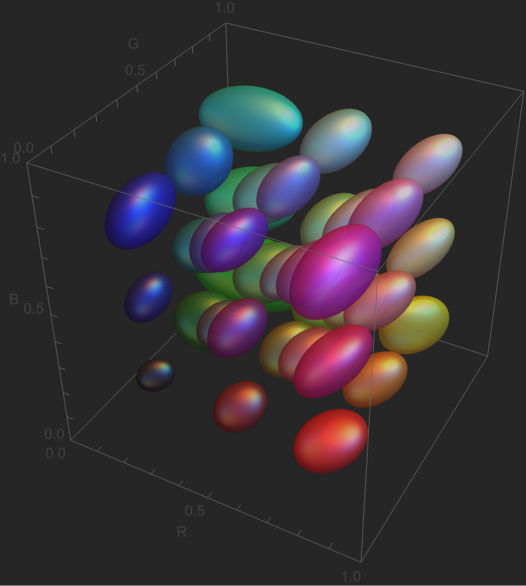

# KoenderColor

A Wolfram Language paclet implementing the empirical three-dimensional metric field for color space described by Jan Koenderink, Andrea van Doorn, Doris I. Braun, and Karl R. Gegenfurtner (2026).

<p align="center">
  
  <br />
  <em>The empirical 3D metric field rendered in sRGB space (reproducing Figure 8 of the paper).</em>
</p>

## Overview

Classical color metrics such as CIEDE2000 apply heuristic weighting functions layered over CIELAB. In contrast, Koenderink et al. empirically measured local regions of **Notable Qualitative Differences (NQD)** throughout the full 3D color cube on a body-centered cubic (BCC) lattice.

At each of the 35 reference locations, color discrimination was probed along 7 orientations (14 directions) and fitted by a Löwner–John minimum-volume bounding ellipsoid:

$$(x - x_0)^T \Sigma(x_0)^{-1} (x - x_0) \le 1$$

`KoenderColor` provides the raw empirical data from the paper (both gamma-encoded sRGB and linear RGB) along with tools for continuous RBF field interpolation, Riemannian metric tensor evaluation, and perceptual distance calculations.

## Features & Tools

* **`KoenderinkData`**: Access the empirical 35-point BCC lattice data and fitted covariance tensors $\Sigma$ (from Appendix Tables A2 and A3).
* **`KoenderinkMetricMatrix`**: Interpolates the $3 \times 3$ symmetric positive-definite covariance matrix $\Sigma(c)$ at any color $c \in [0, 1]^3$ using Gaussian RBF partition of unity.
* **`KoenderinkMetricTensor`**: Computes the Riemannian metric tensor $g(c) = \Sigma(c)^{-1}$.
* **`KoenderinkEllipsoid`**: Generates native Wolfram Language `Ellipsoid[coords, scale^2 * Sigma]` primitives for 3D graphics.
* **`KoenderinkColorDistance`**: Evaluates perceptual color distances in NQD units using:
  * `"Midpoint"`: Fast symmetric chord metric via the midpoint Riemannian tensor.
  * `"LineIntegral"`: Numerical quadrature along straight color paths.
  * `"Geodesic"`: Shortest path along the Riemannian manifold via energy-minimizing relaxation.
* **`FrobeniusMismatch`**: Normalized matrix mismatch $\mu_F(S, T) = \frac{\|S - T\|_F}{\|S\|_F + \|T\|_F}$ (Equation 364).
* **Coordinate Transformations**: Smooth conversion between sRGB and linear RGB (`sRGBToLinearRGB`, `LinearRGBTosRGB`).

## Quickstart

```mathematica
(* Load paclet from local checkout *)
PacletDirectoryLoad["/path/to/koendercolor"];
Needs["KoenderColor`"];

(* 1. Distance between two colors *)
c1 = RGBColor[0.5, 0.5, 0.5];
c2 = RGBColor[0.6, 0.5, 0.5];
KoenderinkColorDistance[c1, c2]
(* Out: ~1.49 NQD units *)

(* 2. Black to white line-integral distance *)
cBlack = RGBColor[0.2, 0.2, 0.2];
cWhite = RGBColor[0.8, 0.8, 0.8];
KoenderinkColorDistance[cBlack, cWhite, "Method" -> "LineIntegral"]
(* Out: ~21.29 NQD units *)

(* 3. Query the local metric tensor g = Sigma^-1 *)
g = KoenderinkMetricTensor[{0.5, 0.5, 0.5}];
MatrixForm[g]

(* 4. 3D visualization of the empirical field *)
Graphics3D[{
  Opacity[0.7],
  Specularity[White, 20],
  Map[
    {Apply[RGBColor, #], KoenderinkEllipsoid[#, "Scale" -> 2.0]} &,
    KoenderinkData["Points"]
  ]
},
  BoxRatios -> {1, 1, 1},
  PlotRange -> {{0, 1}, {0, 1}, {0, 1}},
  Axes -> True,
  AxesLabel -> {"R", "G", "B"},
  Background -> GrayLevel[0.15]
]
```

## Interactive Exploration

An interactive Mathematica notebook is included at [`examples/Exploration.nb`](examples/Exploration.nb), demonstrating:
* Empirical data inspection and matrix positive-definiteness verification.
* 3D rendering of the discrimination ellipsoids.
* Local vs. line-integral distance comparisons.
* Grain volume scaling along the achromatic axis (reproducing Figure 13 of the paper).

## Documentation

Standard Wolfram Reference Notebooks and Guides styled with `Reference.nb` are located in:
* Guide: [`Documentation/English/Guides/KoenderColor.nb`](Documentation/English/Guides/KoenderColor.nb)
* Reference Pages: [`Documentation/English/ReferencePages/Symbols/`](Documentation/English/ReferencePages/Symbols/)

To rebuild all documentation notebooks from source symbol usages, run:
```bash
wolframscript -file scripts/generate_docs.wl
```

## Development & Git Hooks

This repository uses a Git pre-commit hook to automatically increment the build number in `PacletInfo.wl` on each commit (`Version -> "1.0.<build_count>"`):

```bash
git config core.hooksPath .githooks
chmod +x .githooks/pre-commit
```

Large binary assets and documentation assets can be tracked using **Git LFS**.

## Reference

* Koenderink, J., van Doorn, A., Braun, D. I., & Gegenfurtner, K. R. (2026). *An empirical three-dimensional metric field for color space*. bioRxiv preprint [doi:10.64898/2026.03.09.710376](https://doi.org/10.64898/2026.03.09.710376).
